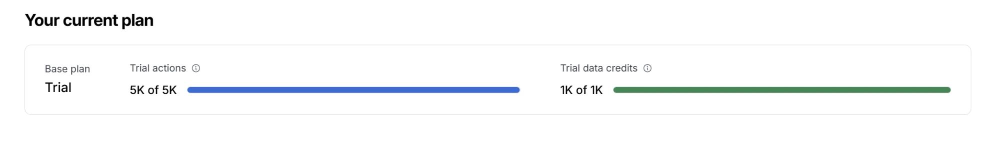
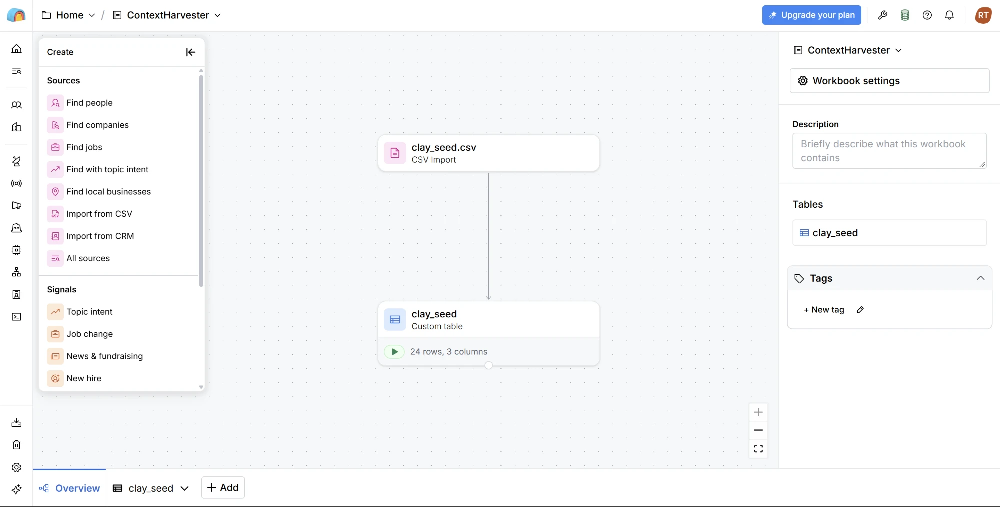
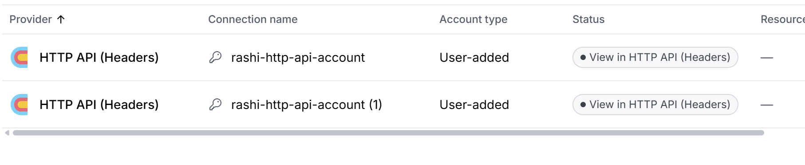
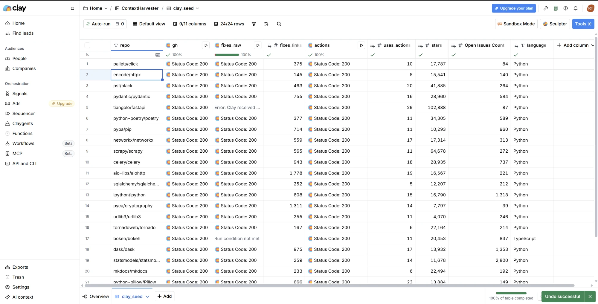
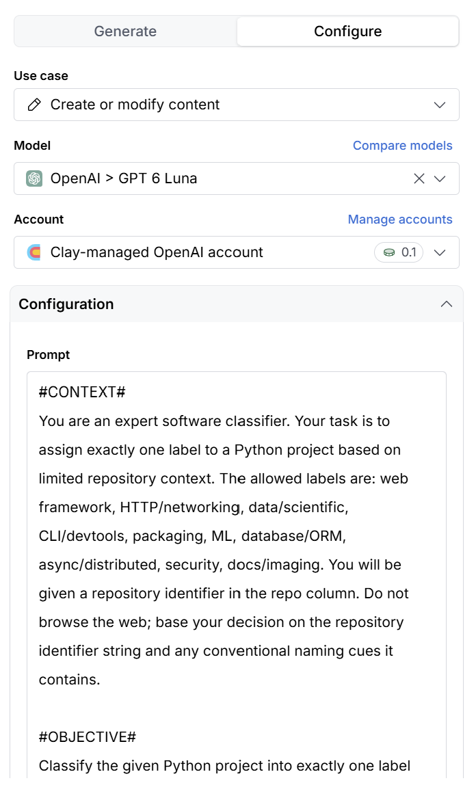

# Evidence of the Clay corpus build

The corpus in `corpus/repos.csv` was built once in Clay on the Growth trial (Oct 9, 2026) and committed. Nothing at runtime calls Clay.

**Screen recording of the build:** https://youtu.be/dfvmURSpRbc

## Screenshots, in build order

1. **Trial allowance.** 5K actions and 1K data credits.
   
2. **Workbook after importing the seed list.** `clay_seed.csv` imported into a custom table of 24 rows.
   
3. **Saved HTTP API (Headers) accounts.** The GitHub token and `User-Agent` live in the saved account, not in the column, so they do not appear in column configs. (A duplicate was created by accident; either works.)
   
4. **The finished table.** Columns `gh`, `fixes_raw`, `fixes_links`, `actions`, `uses_actions`, `stars`, open issues, `language`. Every call returned status 200 except one error on `tiangolo/fastapi`, and `bokeh/bokeh` shows "Run condition not met" because its primary language is TypeScript: the gate skipped the expensive call.
   
5. **Use AI column for domain.** Classifies each surviving repo into one fixed label set, with web browsing disabled; it runs only on rows that passed the filters.
   

## Not captured

Settings screenshots for the `gh`, `fixes_raw` and `actions` HTTP API columns (URL, method, run condition) were not taken during the build. Screenshot 4 shows their results and the gate working; the recording shows the configuration.
